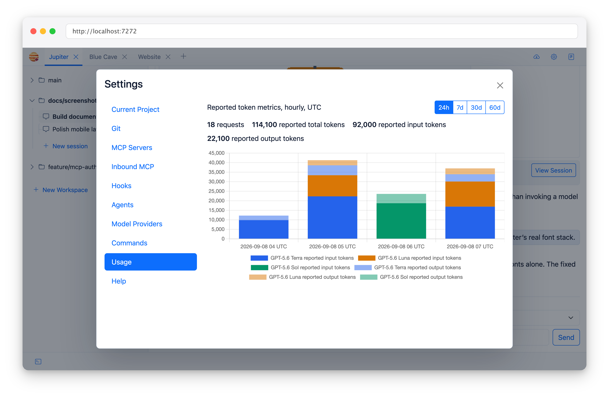

Jupiter keeps local token-usage history so you can answer a fairly basic question: which projects and models are
actually consuming tokens?

## What Gets Recorded?

When a model provider returns data, Jupiter stores input, output, total, cached-input, cache-write, and reasoning token
counts.

It also keeps the operation type and model information. If an agent preference falls back before a request, usage is
recorded against the model that actually handled the request.

Context-compaction usage is tracked separately so its overhead remains visible.

The chat controls also show the latest completed model request's input-token count as a percentage of that model's
context capacity. This is a per-request context-consumption indicator, not cumulative token spend; it updates when a
model response completes and is unavailable when the provider or model does not report the required values.

## Retention

Local usage history is retained for 60 days.
